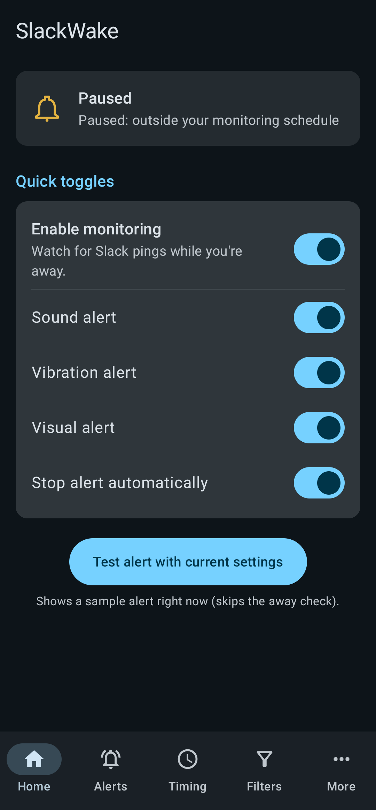
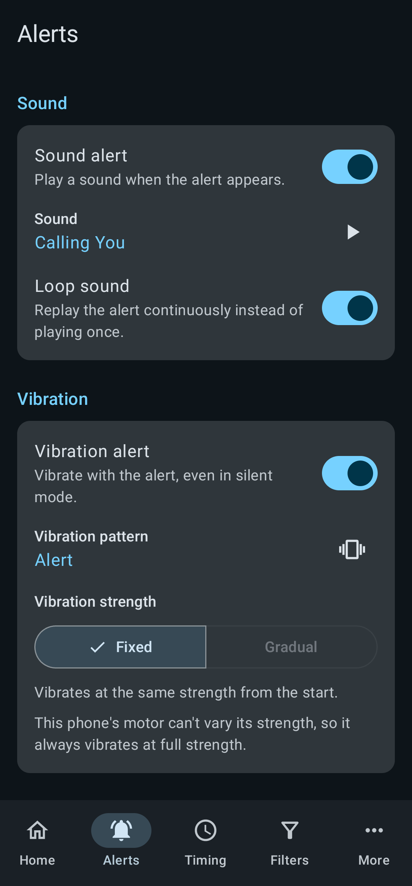
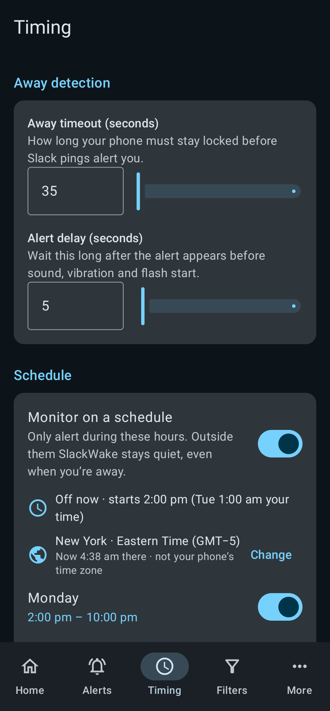
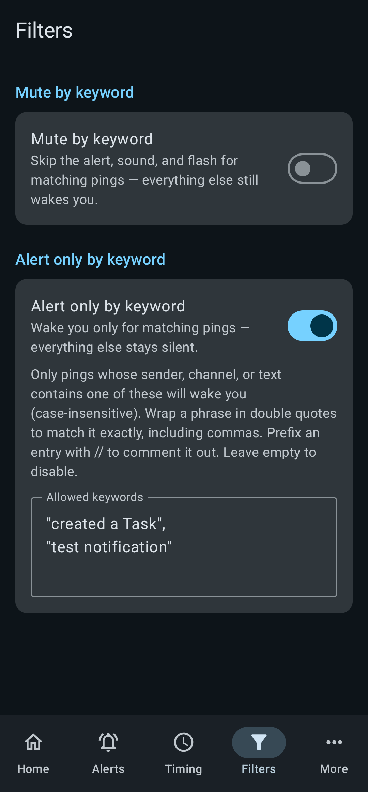
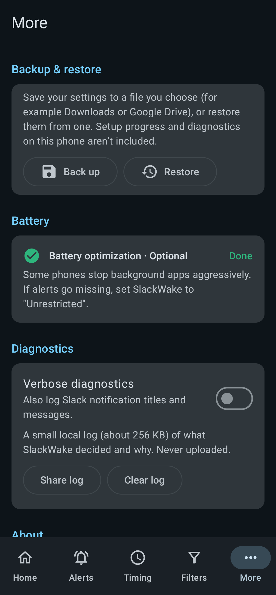

<div align="center">

# SlackWake for Android

**A native Android app that takes over your screen with an alarm when Slack pings you — but only while your phone has been locked and unattended.**

When you're using your phone, Slack's own notifications do the job and SlackWake stays out of the way. When your phone has been sitting locked for a while, the next Slack message lights up the screen (and any connected presentation display) with an unmissable alert, a looping alarm sound and an optional color flash.

[Features](#features) · [Parity with Windows](#feature-parity-with-the-windows-app) · [Getting started](#getting-started) · [Settings](#settings-reference) · [Troubleshooting](#troubleshooting)

</div>

---

## Table of contents

- [Overview](#overview)
- [Features](#features)
- [Screenshots](#screenshots)
- [How it works](#how-it-works)
- [Feature parity with the Windows app](#feature-parity-with-the-windows-app)
- [Technology stack](#technology-stack)
- [Getting started](#getting-started)
  - [Prerequisites](#prerequisites)
  - [Build and run](#build-and-run)
  - [Phone and Slack setup](#phone-and-slack-setup)
- [Settings reference](#settings-reference)
- [Usage](#usage)
- [Development](#development)
- [Build and deployment](#build-and-deployment)
- [Project structure](#project-structure)
- [Security and privacy](#security-and-privacy)
- [Troubleshooting](#troubleshooting)
- [Assumptions, limitations, and known issues](#assumptions-limitations-and-known-issues)
- [License](#license)

---

## Overview

SlackWake for Android is a port of the [Windows SlackWake](https://gitlab.com/rifat.jihan/SlackWake) tray app. It solves the same problem: **you walked away and a Slack message arrived that you needed to see.** A phone face-down on a desk, or across the room, makes a normal notification easy to miss.

SlackWake treats a phone that has been **locked continuously** for longer than a configurable timeout as "away". The next Slack notification then raises a fullscreen alert over the lock screen, plays a looping alarm sound on the alarm stream, and optionally strobes between two colors. Tap anywhere, press back, or press any key (volume keys included) to dismiss it.

**SlackWake never talks to Slack's servers.** The app has no `INTERNET` permission at all. It uses Android's notification-listener API to react to the notifications the Slack app already posts on your phone, filtered to Slack's exact package name, and ignores everything else.

---

## Features

- **Away-gated alerts** — alerts fire only after the phone has been locked for the away timeout (default 5 minutes). Being woken by a notification does *not* count as being back; only unlocking does.
- **Fullscreen alert over the lock screen** — turns the screen on, keeps it on, hides the system bars. Mirrored on any connected presentation display (casting/HDMI).
- **No pop-up over the alert** — while the alert screen is showing, its notification sits quietly in the shade (“Active alert” channel) instead of popping up over it. The heads-up pop-up is used only when the full-screen alert isn’t allowed.
- **Always a notification, sound and vibration** — even if Android won't allow the fullscreen screen, you get a heads-up notification with a **Dismiss** button *and* the alarm sound and vibration. With notifications blocked entirely, the sound and vibration still play.
- **Dismiss any way you like** — tap, back gesture, any hardware key (volume, keyboard), the notification's Dismiss action, or swiping the notification away.
- **Alarm sound** — choose any system alarm, notification or ringtone sound, or your own audio file. Tap a row to preview it. Plays on the **alarm** stream with transient audio focus.
- **Vibration** *(Android-only)* — six patterns (Alert, Heartbeat, Rapid, S.O.S., Staccato, Symphony — the iOS set; "Alert" is the classic 500 ms on/off alarm rhythm), **Fixed** or **Gradual** strength (a crescendo from 15% to your chosen intensity over 5–120 s, like alarm apps' "gradually increase"), intensity 10–100%, tap-to-feel preview. Vibrates as an *alarm*, so it works in silent mode.
- **Looping sound, alert delay, auto-stop** — identical timing to Windows: 0.5 s gap between loops, delay applies to both sound and flash, independent auto-stop for sound and flash.
- **Visual flash** — smooth color strobe with WCAG-contrast text. Capped at 2.5 flashes/second (stricter than Windows) with a photosensitivity warning.
- **Mute by keyword / Alert only by keyword** — same parser and matching rules as Windows.
- **Monitoring schedule** *(Android-only)* — per-day windows ("weekdays 9–6", "every night 11 PM–7 AM"), including windows that cross midnight. Days follow your locale's week order and times your 12/24-hour setting; copy a window to other days in one tap.
- **Backup & restore** *(Android-only)* — save settings to a JSON file anywhere the system file picker reaches (Downloads, Drive, USB), and restore with a confirmation and Undo. A Windows `settings.json` can be restored too. No storage permission; device-specific state (setup progress, diagnostics, the flash-warning choice, an alert sound this phone can't play) is never carried across.
- **Quick Settings tile** — tap to toggle monitoring; subtitle shows Armed / Paused / Disabled.
- **App shortcuts** — long-press the launcher icon for the four tray-menu toggles.
- **Material 3** — dynamic color, light/dark following the system, edge-to-edge, TalkBack labels, font scaling to 200%.
- **Zero network, zero account** — no Slack token, no API calls, no analytics, no crash reporting.

---

## Screenshots
<p align="center">
  
  
  
  
  
</p>

---

## How it works

1. **`SlackNotificationListener`** (a `NotificationListenerService`) is bound by Android once you grant notification access, and re-bound after every reboot. `onNotificationPosted` is event-driven, with no polling. Non-Slack notifications are dropped before anything is parsed or logged.
2. **`NotificationParser`** prefers `MessagingStyle` data (conversation title → channel, latest message's sender → sender, its text → text) and falls back to `EXTRA_TITLE` / `EXTRA_TEXT`. Group summaries, ongoing notifications and your own replies are skipped. **`NotificationDeduper`** drops reposts of the same notification key whose content didn't change.
3. **`AwayTracker`** (pure Kotlin, in `:core`) follows `SCREEN_OFF` / `SCREEN_ON` / `USER_PRESENT` broadcasts registered by the listener service. "Away" means locked continuously for the timeout since the last screen-off that wasn't followed by an unlock. It's evaluated only when a notification arrives.
4. **`AlertGate`** decides: monitoring enabled → no alert already showing → away → not already alerted since the last unlock → keyword filters (allow-list, then mute-list; muting wins).
5. **`AlertController`** owns the single active alert. It *always* posts the alert notification (full-screen intent when allowed, otherwise heads-up) and *always* starts the sound via **`AlertSession`**, independent of whether **`AlertActivity`** manages to appear.

---

## Feature parity with the Windows app

| Windows | Android | Deviation and reason |
| --- | --- | --- |
| Polls `UserNotificationListener` every ~1.5 s | `NotificationListenerService.onNotificationPosted` | Event-driven: no latency, no polling cost. |
| Slack = any app whose name/AUMID contains "slack" | Exact package `com.Slack` (one constant, `SLACK_PACKAGE`) | Fixes the Windows display-name impersonation weakness. |
| Title `#…` → channel, else sender; body = other text lines | MessagingStyle first; same `#` rule for the plain fallback | Android exposes structured conversation data. |
| Toasts already in Action Center at startup ignored | Group summaries, ongoing and own-reply notifications skipped; unchanged reposts of a key ignored (baseline seeded on connect) | Same intent; Android reposts notifications to update them. |
| Idle = no keyboard/mouse input for the timeout (`GetLastInputInfo`) | Away = locked continuously for the timeout since the last screen-off without an unlock | Android has no system-wide input timer. A notification lighting the screen doesn't count as presence. |
| Re-arms as soon as you're idle again | Re-arms only after an unlock and a new away period | A dismissal on the lock screen doesn't prove the user came back. |
| Topmost overlay on every monitor | `AlertActivity` over the lock screen + `Presentation` on each presentation display | Platform convention. Sound plays once, not per display. |
| Overlay 90% opaque (`#E6…`) | Opaque | Translucent windows over the keyguard are unreliable on several OEM builds. |
| Low-level keyboard hook; dismissing key swallowed until released | Any key dismisses on key-up; the down/up pair is consumed | Same effect. The **power key** can't be intercepted by apps. |
| `DisplayWake` (wake monitor, keep it on until dismissed) | `turnScreenOn` + `FLAG_KEEP_SCREEN_ON`, released once auto-stop has stopped the visual flash (or the flash is off); sound and vibration never keep it on | An unattended phone shouldn't keep its screen lit for hours (battery, OLED burn-in). The alert and its notification stay; waking the phone shows the alert again. |
| (no equivalent) | Full-screen-intent permission check (Android 14+) with heads-up fallback, surfaced in the status | Android 14 made full-screen intents user-grantable. |
| WAVs from `C:\Windows\Media`, Browse…, hover preview | RingtoneManager alarm/notification/ringtone sounds + "Choose file…" (persistable URI); tap-to-preview + play/stop button | Touch has no hover. Setting renamed `SoundFilePath` → `SoundUri`. |
| Empty / missing sound → `Ring08.wav` | Empty / unreadable → system default alarm sound (logged) | Platform default. |
| `MediaPlayer`, 0.5 s gap, cap | `MediaPlayer` on `USAGE_ALARM` with transient audio focus; same gap and cap | Volume follows the **alarm** volume. |
| (no equivalent) | **Vibration** channel: pattern, Fixed/Gradual, intensity, build-up time; own auto-stop checkbox; quick toggle | New on Android. Uses alarm usage so Android 13+ doesn't drop it as a background vibration and silent mode doesn't block it. |
| Flash floor 100 ms per half-cycle | Floor **200 ms** (default 500 ms unchanged) + photosensitivity warning | 100 ms = 5 flashes/s, over the WCAG 2.3.1 limit of 3/s. |
| Tray icon: green / amber / slashed | Quick Settings tile + status pill: Armed / Paused / Disabled, same colors & bell | Android has no tray. |
| Tray right-click toggles | Quick toggles at the top of settings + 4 dynamic app shortcuts | — |
| Start with Windows / Start minimized | **Dropped** | Android rebinds the listener after boot once access is granted; `onListenerDisconnected` → `requestRebind`. |
| Test overlay | Test alert (bypasses the away gate) | — |
| WinForms/Fluent color picker | Compose HSV picker with hex + RGB fields and the same 16 presets | Named colors (`red`) no longer accepted; stored values are always `#RRGGBB`. |
| Settings JSON in `%AppData%` | Jetpack DataStore (`files/datastore/settings.json`), same JSON key names | Clamped on read **and** write; corrupt data → defaults. |
| `debug.log` truncated at 256 KB; logs title/body | Two rotating 128 KB files; **no titles/bodies unless "Verbose diagnostics" is on**; Share/Clear in settings; excluded from backup | Privacy. |

---

## Technology stack

| Layer | Choice |
| --- | --- |
| Language | Kotlin 2.4.21, coroutines 1.11.0 |
| UI | Jetpack Compose (BOM 2026.09.00 — Compose 1.12.1, Material 3 1.4.0), Material 3, dynamic color, edge-to-edge |
| Architecture | Single activity for settings/onboarding, MVVM + unidirectional data flow (`ViewModel` + `StateFlow`) |
| DI | Hilt 2.60.1 (KSP 2.3.14) |
| Persistence | Jetpack DataStore 1.3.0 with a kotlinx.serialization JSON serializer |
| Modules | `:core` — pure Kotlin/JVM (filters, contrast, clamps, away/gate, alert timing); `:app` — Android |
| Build | Gradle 9.9.2 (Kotlin DSL, version catalog), AGP 9.2.1, JDK 21 (pinned in `gradle/gradle-daemon-jvm.properties`), minSdk 26, compile/targetSdk 37 |
| Quality | JUnit 4, Turbine, Robolectric 4.18.1, Compose UI tests, Android Lint (warnings as errors), ktlint 1.8.0 |

No third-party runtime dependencies beyond AndroidX/Jetpack, Kotlin libraries and Hilt.

---

## Getting started

### Prerequisites

- **Android 8.0 (API 26)** or newer. The fullscreen-permission screen exists on Android 14+.
- **The Slack app** (`com.Slack`), signed in, with mobile notifications enabled.
- To build: **JDK 21** and the **Android SDK** (platform 37). Android Studio's bundled JDK works; without a JDK 21, Gradle downloads one on the first build.

### Build and run

```sh
./gradlew :app:installDebug       # build + install on a connected device/emulator
```

Or open this folder in Android Studio and press **Run**.

### Phone and Slack setup

The first launch walks you through this. You can revisit it any time in **Settings → Setup**.

1. **Notification access** — lets SlackWake see Slack's notifications. *Settings → Notifications → Device & app notifications → Notification read, reply & control → SlackWake*.
2. **Show notifications** (Android 13+) — needed for the alert and its Dismiss button.
3. **Fullscreen alerts** (Android 14+) — *Settings → Apps → Special app access → Full screen notifications → SlackWake*. Without it you still get a heads-up notification **and** the sound.
4. **Battery** (optional) — if alerts go missing on aggressive OEM builds, set SlackWake's battery usage to *Unrestricted*.
5. **Slack** — in the Slack app: *You → Notifications*. Keep mobile notifications on and avoid DND for pings you need. Slack's own notification sound can be silent: SlackWake plays its own. Then tap **I've turned this on** so the setup checklist marks it done.

> **DND wins.** SlackWake only sees what Slack posts. If Slack is in Do-Not-Disturb, or a channel is muted, there is nothing to react to.

---

## Settings reference

Stored at `files/datastore/settings.json` in app-private storage, using the **same JSON key names** as the Windows `settings.json`. Every value is clamped on read and on write. Corrupt or unreadable data resets to defaults without crashing.

| Key | Type | Default | Range / notes |
| --- | --- | --- | --- |
| `Enabled` | bool | `true` | Master switch. Turning it off also stops an active alert. |
| `IdleTimeoutSeconds` | int | `300` | Away timeout. Clamped **10–7200 s** (slider 10–1800). |
| `SoundEnabled` | bool | `true` | Play the alarm sound. |
| `SoundDelaySeconds` | int | `5` | Delay before sound **and** flash start. Clamped **0–120 s**. |
| `SoundLoop` | bool | `true` | Replay with a 0.5 s gap until dismissed / auto-stopped. |
| `SoundUri` | string | `""` | *Renamed from `SoundFilePath`.* Content/ringtone URI. Empty or unreadable = system default alarm. |
| `FlashEnabled` | bool | `true` | Strobe the alert. Photosensitivity warning shown in onboarding and whenever it's turned on. |
| `FlashIntervalMs` | int | `500` | Half-cycle in ms. Clamped **200–2000 ms** (Windows: 100–2000). |
| `FlashColorA` | string | `#000000` | First flash color, `#RRGGBB`. Invalid → `#000000`. |
| `FlashColorB` | string | `#FFFFFF` | Second flash color. |
| `AlertAutoStopEnabled` | bool | `true` | Auto-stop continuous alerts after the cap. |
| `AlertMaxDurationSeconds` | int | `600` | Cap, measured from when sound/flash start. Clamped **5–3600 s**. When it has stopped the visual flash (or the flash is off), the screen is also allowed to time out, even if sound or vibration keep going; the alert stays until dismissed. |
| `AlertAutoStopIncludesSound` | bool | `true` | Cap stops the sound (even a single long play). |
| `AlertAutoStopIncludesVisual` | bool | `true` | Cap stops the flash (screen returns to black/white). |
| `AlertAutoStopIncludesVibration` | bool | `true` | *Android only.* Cap stops the vibration. |
| `VibrationEnabled` | bool | `true` | *Android only.* Vibrate with the alert (after the alert delay, like sound and flash). Off/hidden on devices without a motor. |
| `VibrationPattern` | string | `"Alert"` | *Android only.* `Alert`, `Heartbeat`, `Rapid`, `SOS`, `Staccato`, `Symphony`. Unknown values → `Alert`. |
| `VibrationIntensityPercent` | int | `100` | *Android only.* Peak strength. Clamped **10–100%**. No effect on motors without amplitude control (the UI says so). |
| `VibrationMode` | string | `"Fixed"` | *Android only.* `Fixed` (constant) or `Gradual` (crescendo from 15% of the intensity). Gradual needs amplitude control. |
| `VibrationRampSeconds` | int | `30` | *Android only.* Gradual build-up time. Clamped **5–120 s**. |
| `KeywordFilterEnabled` | bool | `false` | Mute by keyword (block-list). |
| `KeywordFilterText` | string | `""` | Comma/newline separated; `"quoted phrases"` verbatim (commas allowed); `//` prefix comments an entry out; case-insensitive substring over sender + channel + text; Slack `* _ ~ \`` formatting ignored. |
| `KeywordAllowEnabled` | bool | `false` | Alert only by keyword (allow-list). Empty list is inert. Status reads "armed only for pings matching your keywords". |
| `KeywordAllowText` | string | `""` | Same rules as `KeywordFilterText`. Muting wins on overlap. |
| `VerboseDiagnostics` | bool | `false` | *Android only.* Also log notification titles/text. Warning shown when enabled. |
| `OnboardingCompleted` | bool | `false` | *Android only.* |
| `ScheduleEnabled` | bool | `false` | *Android only.* Only alert inside the per-day windows below. Checked when a ping arrives (no alarms or timers), so it is exact and unaffected by Doze. Status reads "Paused: outside your monitoring schedule" outside them. |
| `ScheduleTimeZone` | string | `""` | *Android only.* IANA zone ID the schedule's times are in (e.g. `America/New_York`); empty = follow the phone's zone. Stored as an ID so the zone's DST rules apply; an invalid ID falls back to the phone's zone. The Schedule section shows the zone and, when it isn't the phone's, its current time. |
| `ScheduleDays` | list | Mon–Fri 09:00–18:00, Sat/Sun off | *Android only.* Seven `{Enabled, StartMinute, EndMinute}` entries, Monday first; minutes after local midnight. A window belongs to the day it starts: if the end is at or before the start it runs into the next day (Mon 23:00–07:00 = Mon 11 PM → Tue 7 AM). Start = end means 24 hours. Overlapping windows merge. |
| `PhotosensitivityWarningDismissed` | bool | `false` | *Android only.* "Don’t show this again" was ticked on the flash warning (only saved when you confirm). |
| `SlackNotificationsConfirmed` | bool | `false` | *Android only.* You ticked off "Slack notifications" in Setup. Android can't read Slack's own notification settings, so this is a manual checklist item; "All set" requires it. |

`StartWithWindows` and `StartMinimized` are not used on Android. If they're present in an imported file, they're ignored.

---

## Usage

- **Status at a glance** — the status card, the Quick Settings tile and the bell icon agree:
  - **Armed** (green bell) — locked long enough; the next Slack ping fires an alert.
  - **Paused** (amber outline) — monitoring is on, but you're using the phone. While you're looking at the settings screen it will always say Paused.
  - **Disabled** (slashed) — monitoring is off.
- **Quick toggles** — top of the settings screen, or long-press the launcher icon: Enable monitoring, Sound alert, Visual alert, Stop alert automatically.
- **Test alert** — "Test alert with current settings" shows the real alert immediately, bypassing the away check.
- **Dismiss** — tap, back, any key, or the notification's Dismiss action. The alert re-arms after you unlock and then leave the phone locked for the timeout again.

---

## Development

```sh
./gradlew ktlintCheck :core:test :app:testDebugUnitTest :app:lintDebug :app:check
./gradlew :app:connectedDebugAndroidTest   # needs a device/emulator
```

- `:core` has no Android dependency. Gate, filter, contrast and timing logic are tested with a fake clock and virtual coroutine time.
- `:app` unit tests use Robolectric (parsing, dedupe, package filter, notification/sound fallback, DataStore, log, Compose components).
- Instrumented tests cover `AlertActivity` dismissal paths and the settings screen.
- `:app:check` includes `verify<Variant>NoInternet`, which fails if any merged manifest gains `INTERNET` or `ACCESS_NETWORK_STATE`.

---

## Build and deployment

```sh
./gradlew :app:assembleRelease   # R8 minify + resource shrinking
```

Release signing is read from Gradle properties (e.g. `~/.gradle/gradle.properties`) or environment variables, **never** from the repository:

```properties
SLACKWAKE_KEYSTORE_FILE=/path/to/release.jks
SLACKWAKE_KEYSTORE_PASSWORD=…
SLACKWAKE_KEY_ALIAS=…
SLACKWAKE_KEY_PASSWORD=…
```

Without them the release APK is built unsigned (as in CI).

**Google Play note:** Play only grants `USE_FULL_SCREEN_INTENT` by default to calling and alarm-clock apps. SlackWake would most likely not qualify, so Play users would have to enable *Full screen notifications* manually (onboarding links there). Until they do, alerts use the heads-up + sound fallback.

---

## Project structure

```
SlackWake.Android/
├── core/src/main/kotlin/…/core/
│   ├── settings/AppSettings.kt     # keys, defaults, clamps, normalized()
│   ├── filter/KeywordFilter.kt     # parser + matching (Windows port)
│   ├── color/                      # hex, HSV, WCAG contrast, overlay palette
│   ├── gate/                       # AwayTracker, AlertGate
│   ├── alert/AlertSession.kt       # delay, loop gap, auto-stop timing
│   └── status/MonitorStatus.kt     # Armed/Paused/Disabled + status sentence
└── app/src/main/kotlin/…/
    ├── listener/                   # NotificationListenerService, parser, dedupe, monitor
    ├── alert/                      # controller, notifier, AlertActivity, AlertScreen
    ├── sound/                      # resolver, alarm player, library, preview
    ├── data/                       # DataStore settings, diagnostic log
    ├── prereq/  status/            # prerequisite checks, deep links, shared status
    ├── tile/  shortcuts/           # Quick Settings tile, app shortcuts
    └── ui/                         # theme, onboarding, settings, components
```

---

## Security and privacy

- **No network access.** The manifest has no `INTERNET` permission, and the build fails if a library adds one.
- **No credentials, no telemetry, no crash reporting.**
- **Scoped to Slack.** Notification access technically exposes every app's notifications. SlackWake checks the package name first and returns immediately for anything that isn't exactly `com.Slack`, without parsing, logging or storing it.
- **Notification content is never persisted.** It's kept in memory only to draw the alert. Dedupe keeps a hash, not text.
- **Diagnostic log** (`files/logs/diagnostic.log`, ~256 KB, rotating): decisions and metadata only. Titles and bodies are recorded only when you turn on *Verbose diagnostics*, after a warning. The log is excluded from cloud backup and device transfer. *Share log* exposes a one-off copy through a FileProvider.
- **Lock-screen visibility.** The alert notification is `VISIBILITY_PRIVATE` (the lock screen shows only "Slack notification received"). The fullscreen alert itself shows the message over the lock screen, like the Windows overlay showed it on an unattended desktop.

---

## Troubleshooting

| Symptom | Likely cause / fix |
| --- | --- |
| Status says notification access is off | Grant it in *Setup → Notification access*. |
| Never armed / never alerts | (1) The phone must stay **locked** for the away timeout. (2) Slack must actually post a notification: check Slack's DND and channel settings. (3) After an alert, SlackWake waits for an unlock before it can fire again. |
| Heads-up notification instead of fullscreen | Android 14+: allow *Full screen notifications* for SlackWake. Fullscreen intents also become heads-up when the phone is unlocked and in use. |
| No sound | Alarm volume is 0, or *Sound alert* is off. A deleted custom file falls back to the default alarm (see the log). |
| No vibration / always full strength | *Vibration alert* off, or the system's *Alarm vibration* / *Vibration & haptics* setting is off. Phones whose motor has no amplitude control ignore intensity and gradual mode. |
| Alerts stop after a while on some phones | OEM battery management. Set SlackWake to *Unrestricted* battery usage. |
| Power button doesn't dismiss | Apps can't intercept the power key. Tap the screen or press a volume key. |
| Keyword mute isn't working | Same rules as Windows: substring, case-insensitive, across sender + channel + text. Quote phrases containing commas. An unquoted `//` entry is a comment. |
| Need more detail | *Diagnostics → Share log*. Temporarily enable *Verbose diagnostics* to include message text. |

---

## Assumptions, limitations, and known issues

- **You only get what Slack posts.** Slack's mobile notification settings and DND are honoured by construction.
- **Away ≠ idle.** Android exposes lock state, not input idleness. A phone unlocked but untouched on a desk is "present".
- **No lock screen:** away falls back to "screen off for the timeout", and any screen-on counts as presence.
- **Ambient display / AOD** doesn't count as presence. A notification that wakes the screen leaves you "away".
- **One alert at a time.** Pings during an alert are dropped.
- **Power key** can't dismiss (platform restriction).
- **Alarm volume** governs loudness. SlackWake doesn't override your volume.
- **Play policy:** see [Build and deployment](#build-and-deployment).
- **Keyword edge case (Windows parity):** a keyword consisting only of formatting characters (e.g. `*`) strips to empty and matches every ping.
- **OEM variance:** full-screen intents, lock-screen activities and background execution differ across manufacturers. Behaviour was verified on an emulator, not on every OEM build.

---

## License

SlackWake for Android is released under the **GNU General Public License v3.0 only**. See [`LICENSE`](LICENSE).

```text
SPDX-License-Identifier: GPL-3.0-only

SlackWake — fullscreen Slack alerts while you're away from your desk.
Copyright (C) 2026 Md. Rifat Hasan Jihan
```
